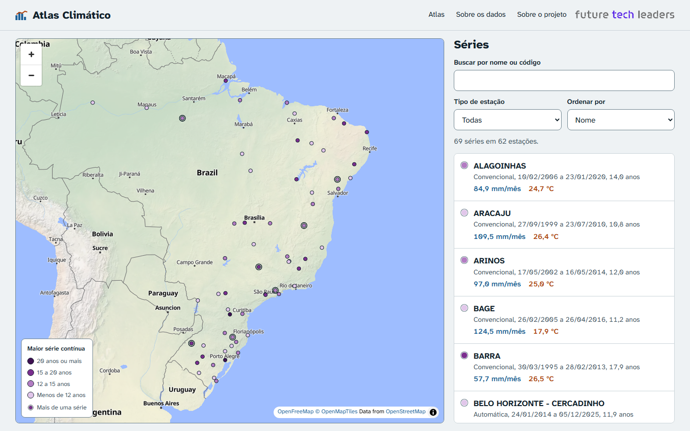
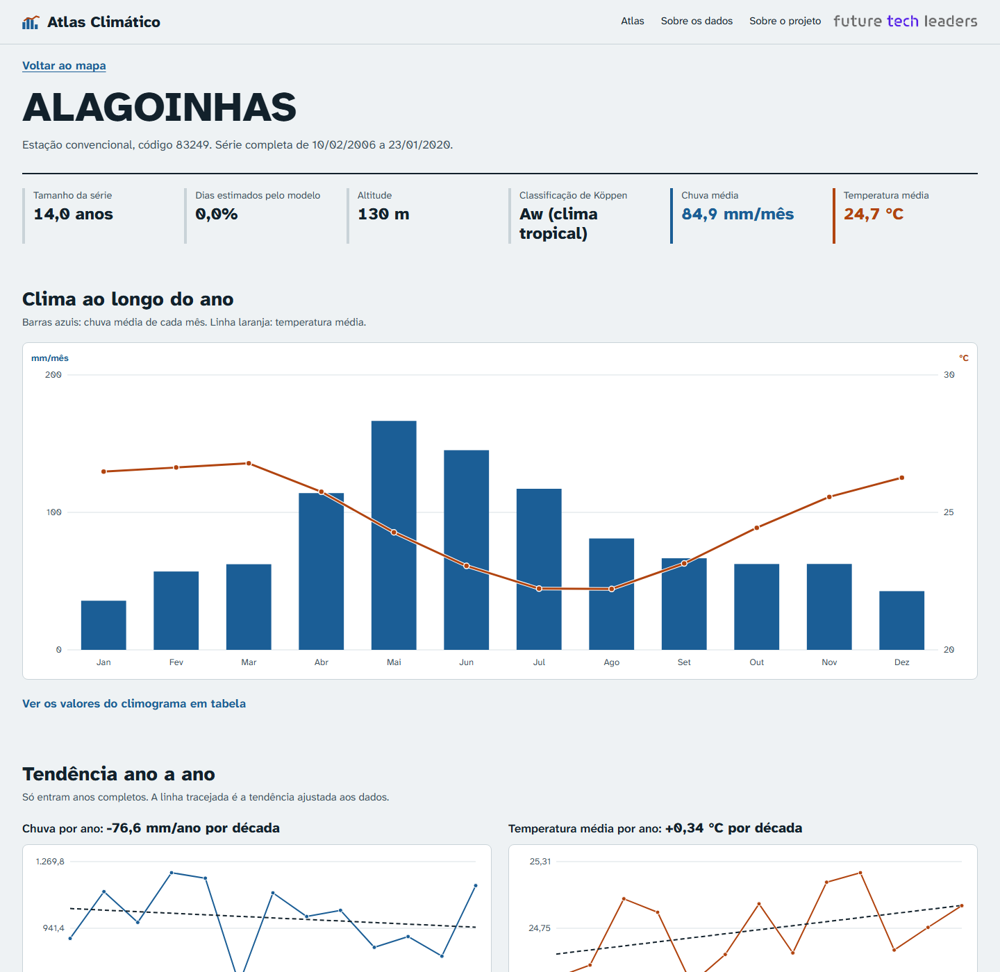
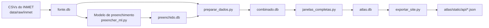

<p align="center">
  
</p>

<h1 align="center">Atlas Climático</h1>

<p align="center">
  Onde o Brasil tem séries longas e completas de chuva e temperatura.<br>
  Estações do INMET com 10 anos seguidos ou mais das duas variáveis, em um mapa.
</p>

<p align="center">
  <a href="https://ghangelo.github.io/Atlas-Climatico-do-Brasil/"><strong>Abrir o atlas</strong></a>
  &nbsp;|&nbsp;
  <a href="#rodar-localmente">Rodar localmente</a>
  &nbsp;|&nbsp;
  <a href="#como-os-dados-são-montados">Como os dados são montados</a>
  &nbsp;|&nbsp;
  <a href="#sobre-o-projeto">Sobre o projeto</a>
</p>

<p align="center">
  
</p>

## O que é

Para saber se uma região ficou mais quente, mais seca ou mais chuvosa, é preciso décadas de medições sem interrupção. As estações do INMET, porém, têm muitas falhas. Este atlas mostra **onde existem pelo menos 10 anos seguidos de chuva e temperatura medidas juntas**, para quem faz estudos ambientais, hidrológicos ou agrícolas encontrar rápido as estações com dados aproveitáveis.

Falhas de até 30 dias são preenchidas por um modelo de aprendizado de máquina. Cada série informa a parcela de dias estimados.

## O que dá para fazer

- **Mapa:** cada ponto é uma estação. Quanto mais escuro, mais longa a maior série contínua. Um anel marca as estações com mais de uma série.
- **Lista:** busca por nome ou código, filtro por tipo de estação (automática ou convencional) e ordenação por anos de série, chuva ou temperatura.
- **Página da série:** climograma, classificação de Köppen, tendência ano a ano e recordes diários, mensais e anuais, com tabelas equivalentes aos gráficos.

<p align="center">
  
</p>

O site é feito de HTML, CSS e JavaScript simples, sem framework nem etapa de compilação. O mapa usa o [MapLibre](https://maplibre.org/) com o fundo do [OpenFreeMap](https://openfreemap.org/), sem chave de API.

## Rodar localmente

Na raiz do projeto, com Python 3:

```bash
python -m atlas.app
```

Abra http://127.0.0.1:8001/. O mapa precisa de internet para carregar os fundos.

O site lê arquivos JSON de `atlas/static/api/`. Por isso ele também funciona sem servidor, no GitHub Pages: o workflow `.github/workflows/pages.yml` publica `atlas/static` a cada push na `main`.

## Como os dados são montados



Para reproduzir, na raiz do projeto e nesta ordem (precisa de NumPy, pandas e scikit-learn, com as versões em `requirements-processamento.txt`):

1. `python pipeline/criar_fonte.py` cria `data/fonte.db` a partir de `data/raw/inmet/`.
2. `python pipeline/preencher_ml.py precipitacao` e `python pipeline/preencher_ml.py temperatura` geram `data/preenchido.db`.
3. `python -m pipeline.preparar_dados` gera `data/combinado.db` (use `--substituir` para recriar).
4. `python -m pipeline.janelas_completas` gera `data/atlas.db` (use `--substituir` para recriar).
5. `python -m pipeline.exportar_site` gera os JSON de `atlas/static/api/`.

Os bancos `.db` e os CSVs originais não ficam no repositório, porque somam cerca de 1,7 GB. Eles são gerados localmente pelos passos acima.

O método de preenchimento e os critérios de aprovação estão em [pipeline/README.md](pipeline/README.md). O fluxo de dados está em [docs/ARQUITETURA.md](docs/ARQUITETURA.md).

## Estrutura do repositório

| Caminho | Finalidade |
| --- | --- |
| `atlas/app.py` | Servidor local que entrega o site e a API |
| `atlas/static/` | O site: página, estilos, script, fontes, imagens e os JSON de `api/` |
| `pipeline/` | Scripts que criam os bancos, preenchem lacunas, montam as séries e exportam o site |
| `docs/` | Arquitetura e imagens deste README |
| `.github/workflows/pages.yml` | Publicação no GitHub Pages |

## Limites

- Dias estimados não são medições, e cada série mostra a parcela estimada.
- Nulos não são zeros.
- O desempenho do modelo nas estações aprovadas tende a ser otimista: o período de 2020 a 2025 também entrou nos critérios de aprovação, então ele não serve mais como teste independente.
- Nas estações automáticas, a temperatura é a média diária, e não a média compensada das convencionais. Não se demonstrou que as duas redes são equivalentes.
- O atlas não tem vínculo oficial com o INMET. Para decisões técnicas ou legais, confira os dados originais.

## Sobre o projeto

Este atlas é o projeto final do bootcamp **Future Tech Leaders**, de tecnologias espaciais, realizado pela Agência Espacial Brasileira (AEB) com o Programa das Nações Unidas para o Desenvolvimento (PNUD), o Istanbul International Center for Private Sector in Development (UNDP ICPSD) e o SDG AI Lab.

O bootcamp foi online e gratuito, com três meses de duração e foco em inteligência artificial, machine learning, sistemas de informação geográfica (SIG) e GeoAI. O atlas aplica esses temas a dados reais: as medições diárias do INMET, o preenchimento de falhas por um modelo de aprendizado de máquina e o mapeamento das séries completas de chuva e temperatura.

<p align="center">
  
</p>

## Fontes

- Medições diárias: [Instituto Nacional de Meteorologia (INMET)](https://portal.inmet.gov.br/), estações convencionais e automáticas.
- Classificação climática de Köppen-Geiger: [Peel et al. (2007)](https://doi.org/10.5194/hess-11-1633-2007), [Beck et al. (2018)](https://doi.org/10.1038/sdata.2018.214) e [Beck et al. (2023)](https://doi.org/10.1038/s41597-023-02549-6).
- Modelo de preenchimento: [Pedregosa et al. (2011)](https://jmlr.org/papers/v12/pedregosa11a.html), biblioteca scikit-learn.
- Mapa: [OpenFreeMap](https://openfreemap.org/), [OpenMapTiles](https://www.openmaptiles.org/) e [colaboradores do OpenStreetMap](https://www.openstreetmap.org/copyright).

## Autor

**Gabriel Henrique Angelo**, curso de Geografia, Universidade Estadual de Maringá (UEM).
[GitHub](https://github.com/ghangelo) | [LinkedIn](https://www.linkedin.com/in/gabrielhangelo)

## Licença

[GNU GPL v3](LICENSE).
